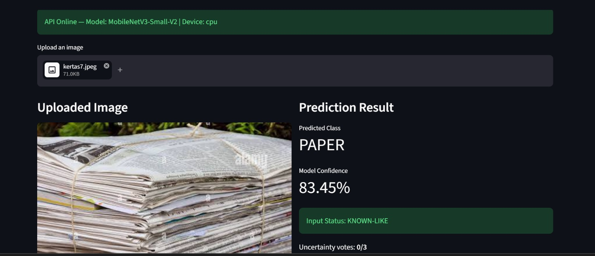
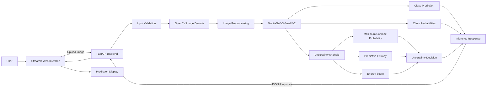

# ♻️ Smart Waste Classification App

### End-to-End Computer Vision Prototype with MobileNetV3, FastAPI, and Streamlit

Smart Waste Classification is an end-to-end computer vision project for classifying waste images into six categories:

**Cardboard · Glass · Metal · Paper · Plastic · Trash**

The project covers the complete AI development workflow—from dataset validation and model experimentation to robustness analysis, REST API integration, and a simple interactive web application.

The final application uses **MobileNetV3-Small V2** as the image classification model, **FastAPI** as the inference backend, and **Streamlit** as the user interface.

> **Project Scope:** Educational and AI Engineering portfolio prototype.  
> This system is not intended to be used as a production waste-sorting solution.

---

## 🖥️ Application Preview

The Streamlit application allows users to upload a waste image and receive:

- Predicted waste class
- Model confidence
- Input status
- Uncertainty indicators
- Class probability distribution



---

## 📌 Project Overview

| Component | Implementation |
|---|---|
| Task | Multi-class Image Classification |
| Number of Classes | 6 |
| Main Framework | PyTorch |
| Final Model | MobileNetV3-Small V2 |
| Computer Vision | OpenCV, Pillow |
| Backend | FastAPI |
| Frontend | Streamlit |
| Internal Test Accuracy | **88.92%** |
| Internal Macro F1 | **0.8624** |
| External Diagnostic Accuracy | **41.67%** |
| Uncertainty Analysis | MSP, Predictive Entropy, Energy Score |

---

## 🎯 Problem Statement

Waste classification is a challenging computer vision problem because different materials may share similar:

- textures,
- colors,
- shapes,
- transparency,
- reflective characteristics,
- and packaging structures.

Another important challenge is **domain shift**.

A model can achieve strong performance on an internal test dataset but behave very differently when exposed to images collected from other sources.

Therefore, this project was developed with two main objectives:

1. Build an effective waste image classifier.
2. Evaluate how the model behaves outside its original training distribution.

Instead of evaluating the system using accuracy alone, this project also investigates:

- Error patterns
- External generalization
- Domain shift
- Confidence calibration
- Uncertainty estimation
- Out-of-Distribution behavior
- AI model deployment

---

# 📊 Dataset

The classification task contains six waste categories:

```text
cardboard
glass
metal
paper
plastic
trash
```

After dataset validation and duplicate checking, the eligible images were divided using a stratified split.

| Dataset Split | Images | Percentage |
|---|---:|---:|
| Training | 1,764 | 69.97% |
| Validation | 378 | 14.99% |
| Internal Test | 379 | 15.03% |

Two additional datasets were prepared for robustness evaluation:

### External Diagnostic Dataset

Internet images representing the same six waste categories.

```text
20 images × 6 classes = 120 images
```

### Out-of-Distribution Dataset

A small collection of images outside the six supported categories, including examples such as:

- animals,
- vehicles,
- food,
- plants,
- electronics,
- clothing,
- and household objects.

---

# 🔍 Data Quality Pipeline

Before model training, several dataset validation and image quality procedures were implemented.

## Dataset Validation

The dataset pipeline checks:

- Expected class structure
- Invalid file formats
- Unreadable images
- Duplicate images
- Cross-dataset duplicates
- Unexpected classes
- Dataset consistency

## Image Quality Analysis

OpenCV-based analysis was used to inspect image properties such as:

- Sharpness
- Brightness
- Image resolution
- Aspect ratio
- Potential review candidates

## Exploratory Data Analysis

EDA was performed to evaluate:

- Class distribution
- Image dimensions
- Brightness distribution
- Dataset balance
- General image characteristics

This process helped ensure that model training was performed on a cleaner and more understandable dataset.

---

# 🧠 Model Development

## 1. Baseline CNN

A lightweight Convolutional Neural Network was first trained from scratch.

The baseline model was intentionally simple and used as a reference point before transfer learning.

The objective of this stage was to answer:

> How well can a small CNN learn this classification task without pretrained visual features?

---

## 2. MobileNetV3 V1

The first transfer-learning experiment used **MobileNetV3 Small pretrained on ImageNet**.

The training strategy included:

- ImageNet pretrained weights
- Weighted Cross Entropy Loss
- Image augmentation
- Frozen feature extractor during initial training
- Partial backbone fine-tuning

The use of pretrained visual representations produced a substantial improvement over the CNN baseline.

---

## 3. MobileNetV3 V2

After analyzing V1 failure cases, a second experiment was developed to improve model robustness.

MobileNetV3 V2 introduced:

- Stronger data augmentation
- Random resized cropping
- Random rotation
- Color jitter
- Random perspective augmentation
- Label smoothing
- AdamW optimizer
- Weight decay
- Deeper backbone fine-tuning
- Three-stage transfer learning

The final application uses:

> **MobileNetV3-Small V2**

---

# 📈 Experimental Results

## Internal Test Performance

All models were evaluated using the same internal test split.

| Model | Accuracy | Macro F1 | Weighted F1 |
|---|---:|---:|---:|
| Baseline CNN | 53.30% | 0.5232 | 0.5460 |
| MobileNetV3 V1 | 86.02% | 0.8212 | 0.8589 |
| **MobileNetV3 V2** | **88.92%** | **0.8624** | **0.8913** |

The transfer-learning models significantly outperformed the CNN trained from scratch.

MobileNetV3 V2 also improved performance on the difficult `trash` category.

```text
Trash Recall

MobileNetV3 V1 : 50%
MobileNetV3 V2 : 75%
```

This improvement indicates better class balance rather than only higher overall accuracy.

---

# 🔬 Internal Error Analysis

The final model performs strongly on the internal dataset distribution.

However, several visually reasonable confusion patterns remain, particularly between:

```text
cardboard ↔ paper
glass ↔ metal
plastic ↔ glass
```

These categories can share similar visual properties such as:

- Material texture
- Transparency
- Reflective surfaces
- Packaging shape
- Object appearance

The confusion matrix was therefore used alongside accuracy and F1 score to better understand model behavior.

---

# 🌍 External Generalization

To evaluate robustness beyond the original dataset distribution, an external diagnostic dataset was created using internet images.

The dataset contained:

```text
20 images × 6 classes = 120 images
```

## External Results

| Model | Accuracy | Macro F1 |
|---|---:|---:|
| MobileNetV3 V1 | 32.50% | 0.3354 |
| **MobileNetV3 V2** | **41.67%** | **0.4391** |

MobileNetV3 V2 improved external performance compared with V1.

However, a substantial generalization gap remained:

```text
Internal V2 Accuracy : 88.92%
External V2 Accuracy : 41.67%
```

This result indicates significant **domain shift** between the original dataset and external internet images.

---

# 🧪 External Failure Analysis

One important pattern observed during external evaluation was a tendency to overpredict the `paper` category.

The external dataset was balanced:

```text
Actual paper images:
20
```

However, the model predicted:

```text
Paper predictions:
41 / 120 images
```

Several classes were incorrectly mapped to `paper`.

Examples included:

```text
cardboard → paper
glass → paper
metal → paper
plastic → paper
trash → paper
```

This suggests that some features learned from the original dataset were not sufficiently robust to changes in:

- Background
- Lighting
- Camera perspective
- Object scale
- Scene complexity
- Image composition

This experiment demonstrates an important machine learning lesson:

> **Strong internal test performance does not automatically guarantee strong real-world generalization.**

---

# 🎯 Confidence Calibration

Temperature scaling was evaluated as a post-hoc confidence calibration method.

External Expected Calibration Error:

```text
Before calibration : 0.1874
After calibration  : 0.2386
```

Instead of improving external calibration, ECE increased.

This suggests that calibration learned from the original validation distribution did not transfer effectively to the domain-shifted external dataset.

Therefore:

> Calibrated probability is not treated as a strict reliability guarantee in the final application.

---

# ⚠️ OOD and Uncertainty Analysis

The project also evaluates model behavior on unsupported images using an Out-of-Distribution dataset.

Three uncertainty signals were investigated:

1. **Maximum Softmax Probability (MSP)**
2. **Predictive Entropy**
3. **Energy Score**

## OOD Detection AUROC

| Method | Internal Test vs OOD | External Known vs OOD |
|---|---:|---:|
| MSP | 0.866 | 0.571 |
| Entropy | 0.881 | 0.576 |
| Energy | **0.894** | **0.577** |

Energy Score achieved the strongest separation between the internal dataset and OOD images.

However, all methods performed substantially worse when external known images were compared with OOD images.

This indicates that the model can detect some distribution differences but cannot reliably distinguish between:

```text
valid domain-shifted waste images
```

and:

```text
truly unsupported images
```

For this reason, the final application uses:

```text
KNOWN-LIKE
```

and:

```text
UNCERTAIN
```

rather than claiming definitive OOD detection.

The uncertainty mechanism should therefore be interpreted as a **heuristic warning system**, not a guaranteed OOD detector.

---

# 🏗️ AI System Architecture



---

# 🔄 Inference Flow

```text
User Uploads Image
        ↓
Streamlit Frontend
        ↓
FastAPI Backend
        ↓
Input Validation
        ↓
OpenCV Image Decode
        ↓
Resize + Center Crop + Normalize
        ↓
MobileNetV3-Small V2
        ↓
Class Prediction
+
Class Probability Distribution
+
Uncertainty Analysis
        ↓
MSP + Entropy + Energy Score
        ↓
KNOWN-LIKE / UNCERTAIN
        ↓
FastAPI JSON Response
        ↓
Streamlit Result Display
```

---

# 🖥️ Web Application

The Streamlit interface provides a lightweight user-facing application for interacting with the AI model.

The interface displays:

- Uploaded image
- Predicted waste category
- Model confidence
- Input status
- Uncertainty votes
- Maximum Softmax Probability
- Predictive Entropy
- Energy Score
- Class probability distribution

Example output:

```text
Predicted Class
PAPER

Model Confidence
83.45%

Input Status
KNOWN-LIKE

Uncertainty Votes
0 / 3
```

---

# 🔌 REST API

The model inference system is exposed through a FastAPI backend.

## Available Endpoints

| Method | Endpoint | Description |
|---|---|---|
| `GET` | `/` | API information |
| `GET` | `/health` | API and model health |
| `GET` | `/classes` | Supported waste classes |
| `POST` | `/predict` | Predict an uploaded image |

## Example Prediction Response

```json
{
  "filename": "sample.jpg",
  "prediction": "plastic",
  "confidence": 0.82,
  "status": "KNOWN_LIKE",
  "uncertainty_votes": 0,
  "uncertainty": {
    "msp": 0.82,
    "entropy": 0.41,
    "energy": -3.21
  }
}
```

FastAPI automatically provides interactive Swagger documentation at:

```text
http://127.0.0.1:8000/docs
```

---

# 📁 Project Structure

```text
smart-waste-classification/
│
├── api/
│   ├── __init__.py
│   └── main.py
│
├── app/
│   └── main.py
│
├── data/
│   ├── raw/
│   ├── processed/
│   ├── splits/
│   └── external/
│       ├── internet/
│       └── ood/
│
├── models/
│   ├── baseline_cnn.pth
│   ├── best_mobilenet.pth
│   └── best_mobilenet_v2.pth
│
├── notebooks/
│
├── results/
│   ├── baseline/
│   ├── mobilenet/
│   └── mobilenet_v2/
│
├── src/
│   ├── dataset.py
│   ├── image_quality.py
│   ├── review_candidates.py
│   ├── external_review.py
│   ├── eda.py
│   ├── split_dataset.py
│   ├── torch_dataset.py
│   ├── train_baseline.py
│   ├── evaluate_baseline.py
│   ├── error_analysis_baseline.py
│   ├── train_transfer.py
│   ├── evaluate_transfer.py
│   ├── train_transfer_v2.py
│   ├── evaluate_transfer_v2.py
│   ├── evaluate_external.py
│   ├── evaluate_external_v2.py
│   ├── error_analysis_external.py
│   ├── calibrate_temperature.py
│   ├── evaluate_ood.py
│   └── inference.py
│
├── tests/
│
├── app_prediction.png
├── .gitignore
├── requirements.txt
└── README.md
```

---

# 🛠️ Technology Stack

## Machine Learning

- Python
- PyTorch
- Torchvision
- Scikit-learn
- MobileNetV3

## Computer Vision

- OpenCV
- Pillow

## Data Analysis

- Pandas
- NumPy
- Matplotlib

## Backend

- FastAPI
- Uvicorn

## Frontend

- Streamlit

---

# ⚙️ Installation

## 1. Clone the Repository

```bash
git clone <YOUR_REPOSITORY_URL>
cd smart-waste-classification
```

## 2. Create a Virtual Environment

```bash
python -m venv .venv
```

## 3. Activate the Environment

### Windows PowerShell

```powershell
.\.venv\Scripts\Activate.ps1
```

## 4. Install Dependencies

```bash
pip install -r requirements.txt
```

---

# 🚀 Running the Application

The application requires two processes:

```text
FastAPI Backend
+
Streamlit Frontend
```

## 1. Start FastAPI

From the project root:

```bash
python -m uvicorn api.main:app --reload
```

The API will run at:

```text
http://127.0.0.1:8000
```

Swagger documentation:

```text
http://127.0.0.1:8000/docs
```

---

## 2. Start Streamlit

Open another terminal and run:

```bash
python -m streamlit run app/main.py
```

The web interface will run at:

```text
http://localhost:8501
```

---

# ⚠️ Known Limitations

## Domain Shift

The main limitation is the performance gap between internal and external datasets:

```text
Internal Accuracy : 88.92%
External Accuracy : 41.67%
```

This indicates limited robustness to substantial changes in image distribution.

---

## External Class Bias

The model tends to overpredict the `paper` category on external images.

---

## OOD Detection

The uncertainty system is heuristic and does not reliably reject every unsupported input.

Some unrelated images may still receive:

```text
KNOWN-LIKE
```

status.

The system therefore does not claim definitive OOD detection.

---

## Single-Label Classification

The model assumes that each image contains one dominant waste category.

Images containing multiple materials may therefore be ambiguous.

---

## Dataset Scale

The training dataset is relatively small compared with large-scale datasets typically used for production computer vision systems.

---

# 🔮 Future Improvements

Potential future work includes:

- Collecting a larger real-world waste dataset
- Improving domain diversity
- Domain-specific fine-tuning
- More systematic external benchmark construction
- Feature-space OOD detection
- Dedicated OOD models
- Improved confidence calibration
- Multi-object waste detection
- ONNX model export
- Model quantization
- Cloud deployment
- Mobile inference
- Model monitoring
- Continuous model evaluation

---

# 💡 Key Takeaways

The project evolved through several stages:

```text
Dataset Validation
        ↓
Exploratory Data Analysis
        ↓
Baseline CNN
        ↓
Transfer Learning
        ↓
MobileNetV3 V1
        ↓
External Evaluation
        ↓
Failure Analysis
        ↓
MobileNetV3 V2
        ↓
Confidence Calibration
        ↓
OOD Analysis
        ↓
Inference Pipeline
        ↓
FastAPI
        ↓
Streamlit Application
```

The main takeaway from this project is that AI model development should not stop at achieving a high internal accuracy score.

The project demonstrates practical experience with:

- Data validation
- Computer vision preprocessing
- Transfer learning
- Model fine-tuning
- Error analysis
- Domain shift
- Confidence calibration
- Uncertainty estimation
- OOD analysis
- REST API development
- AI model deployment
- Interactive application development

---

# 👤 About This Project

Developed as an **AI Engineering portfolio project** by a Data Science student interested in:

- Artificial Intelligence
- Machine Learning
- Computer Vision
- AI Engineering


